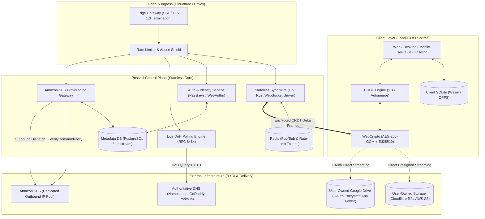
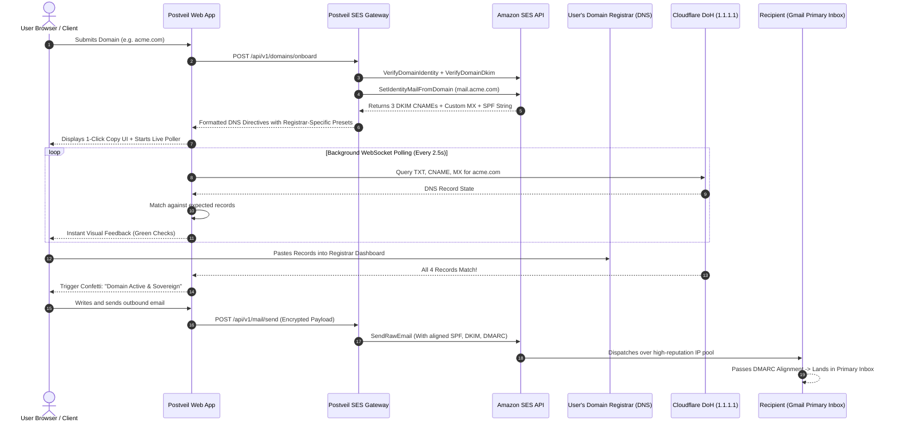
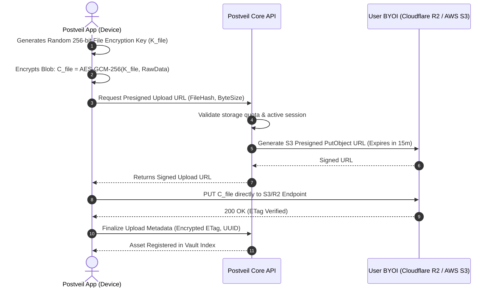
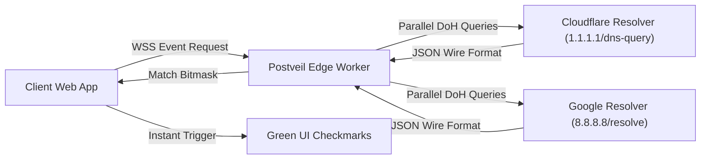

# Postveil: Fully-Realized System Architecture Specification

> **Version:** 1.0.0-PROD  
> **Status:** Architecture Design Record (ADR)  
> **Target Release:** Q4 2026  
> **Author/Architect:** Engineering Team  
> **Classification:** Technical System Specification  

---

## 1. Executive Overview & System Topology

**Postveil** is an open-source, local-first, zero-knowledge sovereign workspace platform designed as an anti-monopoly alternative to Google Workspace and Microsoft 365. 

Postveil anchors user identity to **custom domain ownership** while eliminating cloud storage and compute liabilities through a **Decoupled Bring-Your-Own-Infrastructure (BYOI)** architecture.

```
                                 ┌────────────────────────────────────────────────────────┐
                                 │                   POSTVEIL PLATFORM                    │
                                 │              Root Identity: you@domain.com             │
                                 └───────────────────────────┬────────────────────────────┘
                                                             │
                  ┌──────────────────────────┬───────────────┴──────────────┬──────────────────────────┐
                  ▼                          ▼                              ▼                          ▼
         ┌─────────────────┐        ┌─────────────────┐            ┌─────────────────┐        ┌─────────────────┐
         │     P-MAIL      │        │     P-DOCS      │            │     P-DRIVE     │        │   P-CALENDAR    │
         │ (Communication) │        │   (Knowledge)   │            │    (Storage)    │        │     (Time)      │
         ├─────────────────┤        ├─────────────────┤            ├─────────────────┤        ├─────────────────┤
         │ • Custom Domain │        │ • Offline CRDT  │            │ • BYO S3 / R2   │        │ • Personal/Team │
         │ • SES Delivery  │        │ • Hybrid Canvas │            │ • E2E Encrypted │        │ • Public Booking│
         │ • DoH Live DNS  │        │ • 0ms Latency   │            │ • Zero-Egress   │        │ • Offline Task  │
         └─────────────────┘        └─────────────────┘            └─────────────────┘        └─────────────────┘
                  ▲                          ▲                              ▲                          ▲
                  └──────────────────────────┴───────────────┬──────────────┴──────────────────────────┘
                                                             │
                                            ┌────────────────┴────────────────┐
                                            │      STATELESS SYNC WIRE        │
                                            │   Go / Rust WebSocket Relay     │
                                            └─────────────────────────────────┘
```

### 1.1 Core Engineering Principles

1. **Local-First as Primary State:** The client device (browser/desktop/mobile) is the authoritative source of truth. All reads and writes hit in-memory SQLite first (0ms latency). The network is an asynchronous reconciliation channel.
2. **Zero-Knowledge by Default:** Client devices derive symmetric AES-256-GCM encryption keys locally via WebCrypto/Passkeys. The central relay server never holds decryption keys or plaintext file bytes.
3. **Pure Bring-Your-Own-Infrastructure (BYOI):** Storage payloads (documents, drive archives, email attachments) bypass Postveil servers entirely via pre-signed, direct-to-cloud streams targeting user-owned Google Drive, Apple iCloud, Cloudflare R2, or AWS S3.
4. **Registrar-Agnostic Usability:** Complete abstraction of domain verification via RFC 8484 DNS-over-HTTPS (DoH) real-time polling, supporting any global domain registrar without requiring nameserver migration.
5. **Deterministic Email Deliverability:** Automated programmatic provisioning of Amazon SES Domain Identities with custom `MAIL FROM` subdomain alignment, guaranteeing primary inbox placement on Gmail and Outlook.

---

## 2. Global System Architecture Diagram



---

## 3. Pillar-by-Pillar Component Architecture

### 3.1 Pillar 1: P-MAIL (Email & Domain Identity Engine)

P-Mail is an authenticated, deliverable custom-domain mail system engineered around Amazon SES with programmatic domain alignment.



#### Technical Deliverability Blueprint:
1. **Easy-DKIM 3-CNAME Protocol:** Generates 3 unique tokens pointing to `token.dkim.amazonses.com`.
2. **Custom `MAIL FROM` Subdomain:** Sets `mail.userdomain.com` pointing to `feedback-smtp.<region>.amazonses.com`. This ensures the envelope sender domain matches the `From:` header domain, satisfying **DMARC Identifier Alignment (Strict/Relaxed)**.
3. **Automated DMARC Ingestion:** Provides a default p-policy string: `v=DMARC1; p=none; rua=mailto:dmarc-reports@postveil.com;`.

---

### 3.2 Pillar 2: P-DOCS (Living Local-First CRDT Knowledge Canvas)

P-Docs merges document writing, nested project wikis, and structured tables into a single offline-first surface.

```
  ┌─────────────────────────────────────────────────────────────┐
  │                    P-DOCS RUNTIME ENGINE                    │
  ├─────────────────────────────────────────────────────────────┤
  │  Client Editor:    Tiptap / BlockSuite (Rich Text + Blocks) │
  │  State Container:  Yjs Document (CRDT Tree)                 │
  │  Storage Provider: IndexedDB / OPFS via y-indexeddb         │
  │  Sync Provider:    y-websocket with Custom Binary Packets   │
  │  Security Filter:  WebCrypto Subtly Encrypts Updates        │
  └─────────────────────────────────────────────────────────────┘
```

#### Sync & Collision-Resolution Lifecycle:
1. **Local Mutation:** Every keystroke creates an incremental update vector in memory.
2. **Local Commit:** Update vector commits to local browser storage (`IndexedDB`/`SQLite`). UI reflects the update in **0.0ms**.
3. **Frame Encryption:** Update vector is encrypted using symmetric key $K_{\text{doc}}$:
   $$\text{Ciphertext} = \text{AES-GCM-256}(K_{\text{doc}}, \text{IV}, \Delta_{\text{Yjs}})$$
4. **Relay Dispatch:** Binary frame broadcasts over WebSocket to the stateless Postveil sync wire.
5. **Relay Fanout:** Server fans out the binary frame to all authenticated peer devices subscribed to `room:doc_id`. The server cannot inspect or parse the document contents.

---

### 3.3 Pillar 3: P-DRIVE (Zero-Knowledge Decoupled Asset Vault)

P-Drive decouples the storage host from the application logic.



#### Zero-Egress Economics:
* Files are uploaded and downloaded **directly** between the client device and the storage provider.
* Postveil servers **never proxy the file bytes**, resulting in **\$0.00 bandwidth egress fees**.
* Supports two consumer tiers:
  * **Option A (Non-Techies):** 1-Click Google Drive OAuth (`drive.file` scope creates an isolated, encrypted hidden app data folder).
  * **Option B (Power Users/Teams):** S3 API tokens for Cloudflare R2, AWS S3, Wasabi, or on-prem MinIO.

---

### 3.4 Pillar 4: P-CALENDAR (Time, Coordination & Booking Links)

P-Calendar unifies scheduling with the local-first document engine and outbound mail infrastructure.

* **Local Event Storage:** Events are modeled as deterministic JSON entities inside SQLite.
* **Calendly-Killer Engine:**
  1. User defines availability windows (e.g., Monday–Thursday, 09:00–17:00).
  2. Client publishes an encrypted availability bitmask to the public booking edge.
  3. External clients view `postveil.com/meet/username` without authentication.
  4. Selected booking time slots trigger an authenticated Amazon SES confirmation email to both parties with an `.ics` attachment.
  5. The meeting automatically binds an S-Doc template for live collaborative meeting notes.

---

## 4. Cryptographic & Security Architecture

Postveil operates on a strict **Zero-Knowledge Architecture (ZKA)**. The server operates as an untrusted message relay.

```
                       USER MASTER PASSPHRASE / PASSKEY
                                     │
                                     ▼
                    Argon2id (Salt, Time=3, Memory=64MB)
                                     │
         ┌───────────────────────────┴───────────────────────────┐
         ▼                                                       ▼
  MASTER ENCRYPTION KEY (MEK)                             DEVICE IDENTITY KEY
  [AES-256-GCM]                                           [Ed25519 Pair]
         │                                                       │
         ├─────────────────────────────────┐                     └─► Public Key
         ▼                                 ▼                         (Registers on Relay)
  VAULT KEY (K_vault)               SYNC KEY (K_sync)
  Encrypts files & assets           Encrypts CRDT delta frames
  before S3/Drive upload            before WebSocket relay
```

### 4.1 Key Derivation Function (KDF) Specs
* **Primitive:** `Argon2id` (WebAssembly implementation on Web; native C library on Mobile/Desktop).
* **Parameters:** Memory = 64 MB, Iterations = 3, Parallelism = 4.
* **Authentication:** FIDO2 WebAuthn Passkeys register a public key on the server; the private key protects the local credential vault via hardware secure enclaves (Apple Secure Enclave, Android Keystore, Windows Hello TPM).

### 4.2 Account Recovery Architecture
Postveil maintains no backdoors. Recovery is facilitated via a **BIP-39 12-Word Mnemonic Phrase**:
* Derived deterministically at account initialization.
* Encrypts a recovery payload containing the Master Encryption Key.
* Without the 12-word seed phrase or an authenticated device passkey, data is cryptographically unrecoverable.

---

## 5. Live Registrar-Agnostic DoH DNS Verification Engine

To eliminate nameserver migration friction, Postveil executes live DNS checks directly against authoritative resolvers via **RFC 8484 (DNS-over-HTTPS)**.



### Verification Matrix Evaluation Criteria:
1. **MX Record:** Matches `10 feedback-smtp.<region>.amazonses.com` (or regional endpoint).
2. **SPF Record:** TXT record matching `v=spf1 include:amazonses.com ~all`.
3. **DKIM Verification:** 3 CNAME queries matching `*.domainkey.amazonses.com`.
4. **DMARC Record:** TXT record matching `v=DMARC1; p=...`.

---

## 6. Monorepo Repository Structure (`D:/GitHub/Postveil`)

```
D:/GitHub/Postveil/
├── .github/
│   ├── workflows/               # CI/CD pipelines (Test, Lint, Release, Security Audit)
│   └── ISSUE_TEMPLATE/          # Issue & feature request standards
├── apps/
│   ├── web/                     # SvelteKit / Tailwind core web application
│   ├── desktop/                 # Tauri (Rust) desktop shell (macOS, Windows, Linux)
│   └── mobile/                  # React Native / Expo shell (iOS, Android)
├── packages/
│   ├── crdt/                    # Yjs & Automerge state sync wrappers
│   ├── crypto/                  # WebCrypto, Argon2id, and key management primitives
│   ├── db/                      # SQLite schema, migrations, and local FTS5 search
│   ├── dns/                     # DoH client & registrar-specific formatting rules
│   └── ui/                      # Shared design system (Shadcn-Svelte + Tailwind)
├── services/
│   ├── relay/                   # Go-based stateless WebSocket CRDT sync wire
│   ├── ses-gateway/             # Go/Python service managing Amazon SES identities
│   └── doh-poller/              # Cloudflare Worker / Edge DoH DNS validator
├── infra/
│   ├── docker/                  # Local evaluation Docker Compose files
│   ├── terraform/               # Production cloud infrastructure definitions
│   └── k8s/                     # Kubernetes Helm manifests for scalable enterprise deployments
├── scripts/
│   ├── dev-setup.sh             # 1-command developer environment bootstrap
│   └── seed-db.ts               # Local development fixtures
├── ARCHITECTURE.md              # System Architecture Specification (This Document)
├── CONTRIBUTING.md              # Contributor guidelines
├── LICENSE                      # AGPLv3 License
└── README.md                    # Primary repository overview
```

---

## 7. Production Infrastructure & Operating Budget

### 7.1 Infrastructure Sizing (10,000 Active Daily Users)

| Service | Technology | Provider | Specs | Monthly Cost |
|---|---|---|---|---|
| **Sync Relay Nodes** | Go / Rust Binary | Hetzner Cloud / Fly.io | 2x Dedicated vCPU, 4GB RAM | **\$14.00** |
| **Edge Ingress / CDN** | Cloudflare Pages / Workers | Cloudflare | Unlimited Static Requests | **\$5.00** |
| **Email Relay Pipeline** | Amazon SES | AWS | ~500,000 outbound emails/mo | **\$50.00** |
| **DNS Resolution Cache** | Cloudflare DoH | Cloudflare | Free public resolver | **\$0.00** |
| **Metadata DB (Auth only)**| PostgreSQL (Litestream) | Hetzner / Supabase Self-Host| Managed 2-core instance | **\$15.00** |
| **Object Storage (Internal)**| Cloudflare R2 | Cloudflare | Static assets & thumbnails | **\$5.00** |
| **User Data Storage** | BYOI (Google Drive / S3) | User-Owned | Offloaded to user accounts | **\$0.00** |
| **TOTAL ESTIMATED MONTHLY OPEX** | | | | **\$89.00 / mo** |

### 7.2 Scalability Profile
* **Concurrency:** A single 2-core Go relay node manages **50,000+ simultaneous WebSocket connections** due to minimal memory consumption per socket (~8 KB per idle client).
* **Bandwidth Overhead:** CRDT delta updates average **under 200 bytes per keystroke**, resulting in negligible server egress bandwidth.

---

## 8. Anti-Abuse & Deliverability Protection Safeguards

Because Postveil provides outbound email sending, automated defenses prevent IP blacklist contamination:

1. **The 24-Hour Sandbox Quota:** Newly onboarded domains are restricted to **20 outbound emails for their first 24 hours**. This neutralizes 99% of disposable spambots while remaining unnoticeable to real humans.
2. **Automatic Bounce & Complaint Webhooks:** AWS SES SNS notifications are mapped directly to Postveil webhooks. If a domain generates a **complaint rate exceeding 0.1%** or a **bounce rate exceeding 5.0%**, outbound sending for that domain is immediately paused.
3. **Domain Age Verification:** Domains registered under 48 hours ago require an additional FIDO2 passkey verification step before outbound SES pipelines unlock.

---

## 9. Conclusion & Implementation Sequence

This architecture delivers a complete, production-grade alternative to Google Workspace that is:
* **Infrastructurally lightweight:** Server bills scale with accounts, not user gigabytes.
* **Commercially viable:** Enables 96%+ gross margins through BYOI decoupling.
* **Technically defensible:** Protected by the Amazon SES deliverability pipeline and local-first CRDT engineering.

*Proceed to Phase 1: Repository initialization and development of the core Go sync wire and Amazon SES verification gateway.*
