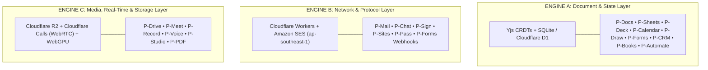

# Postveil: The 20 Sovereign Pillars

> **Architectural Specification & Complete Functional Manifesto**  
> *Version:* 1.0.0 • *Target Ecosystem:* Sovereign Cross-Platform (Web PWA, Desktop Tauri 2.0, Mobile Capacitor)  
> *Underlying Cloud Engine:* Cloudflare Workers (Edge Compute) • Cloudflare D1 (SQLite) • Cloudflare R2 (Private Object Vault) • Amazon SES (Global Deliverability)

---

## Executive Summary: The Postveil Paradigm

Postveil is not a loose bundle of micro-apps. It is a unified **Autonomous Company Operating System (OS)** engineered to systematically replace the entire corporate SaaS rent-seeking ecosystem—Google Workspace, Microsoft 365, Slack, Calendly, DocuSign, Canva, Loom, 1Password, QuickBooks, HubSpot, and Zapier—with a single, sovereign, local-first platform.

### The 4 Non-Negotiable Architectural Tenets (The "ArtCraft Standard")

1. **Local-First & Client-Side Compute:** 95% of execution happens on the user's local silicon via WebAssembly, WebCrypto, WebAudio, and HTML5 Canvas. Server costs to the founder are near \$0.00.
2. **Sub-4-Millisecond Latency:** Every keystroke, triage command, and layer manipulation operates with zero loading wheels, backed by optimistic UI state and background synchronizations.
3. **Zero Hostage Formats (True Digital Permanence):** Every piece of data stores natively in standard open formats (`.md`, `.eml`, `.csv`, `.docx`, `.xlsx`, `.pptx`, `.pdf`, `.ics`, `.svg`, `.sqlite`) or open zipped containers (`.pdoc`, `.psheet`, `.pdesign`), with instant 1-click universal export.
4. **Decoupled Sovereign Storage:** Postveil holds zero customer data captive. Storage cascades across the user's local device storage (OPFS), private Cloudflare R2 buckets (\$0 egress), and virtual striped Google Drive partitions (`appdata` with a mandatory 2 GB Gmail safety buffer).

---

## The 20 Pillars Matrix

```
┌────────────────────────────────────────────────────────────────────────────────────────┐
│                        POSTVEIL: THE 20-PILLAR SOVEREIGN SUITE                         │
├────────────────────┬────────────────────┬────────────────────┬─────────────────────────┤
│ 1. ✉️ P-Mail       │ 2. 📅 P-Calendar   │ 3. 📹 P-Meet       │ 4. 💬 P-Chat            │
│ 5. 📝 P-Docs       │ 6. 📊 P-Sheets     │ 7. 📽️ P-Deck       │ 8. 🎨 P-Draw            │
│ 9. 🎙️ P-Voice      │ 10. 📁 P-Drive     │ 11. 🖌️ P-Studio    │ 12. 📑 P-PDF            │
│ 13. 🎥 P-Record    │ 14. ✍️ P-Sign      │ 15. 📋 P-Forms     │ 16. 💳 P-Books          │
│ 17. 👥 P-CRM       │ 18. 🔐 P-Pass      │ 19. 🌐 P-Sites     │ 20. ⚡ P-Automate       │
└────────────────────┴────────────────────┴────────────────────┴─────────────────────────┘
```

---

# Detailed Pillar Specifications

---

## Category I: Core Communication & Coordination (The Identity Anchor)

### 1. ✉️ `P-Mail` (The Custom-Domain Email & Deliverability Engine)
* **Replaces:** Google Workspace Gmail, Microsoft Outlook, Superhuman (\$30/mo).
* **Core Purpose:** The primary retention anchor of Postveil. Provides instant custom-domain mailbox creation (`name@domain.com`), automated registrar DNS configuration, spam screening, and verified inbox deliverability.
* **Functional Specifications:**
  * **Superhuman-Speed Triage:** Single-key keyboard navigation (`J`/`K` navigation, `E` archive, `R` reply, `U` undo-send, `/` instant search).
  * **DoH Automated DNS Polling:** Built-in RFC 8484 DNS-over-HTTPS engine continuously polls root name servers (Cloudflare, Dynadot, GoDaddy, Namecheap) to verify TXT ownership, MX records, SPF, and DKIM tokens with instant visual green checkmarks.
  * **Unified Inbound/Outbound:** Inbound mail staged in S3 and processed by serverless Lambda directly into Cloudflare D1/R2; outbound mail dispatched via Amazon SESv2.
  * **Privacy Shield:** Remote pixel tracking blocker, CSS proxying, HTML sanitization via DOMPurify, and one-click spam/phishing quarantine.
* **Technical Engine:** Cloudflare Workers, PostalMime parser, Cloudflare D1 (indexes), Cloudflare R2 (RFC 822 raw message storage), Amazon SESv2 (`ap-southeast-1`).
* **Format & Storage:** Standard `.eml`, `.mbox` bulk export, encrypted JSON thread states.
* **Economics:** \$0.10 per 1,000 outbound emails via raw SES. Zero server cost for reading or indexing.

---

### 2. 📅 `P-Calendar` (Unified Scheduling & Public Booking Links)
* **Replaces:** Google Calendar, Calendly (\$12/user/mo), Cal.com.
* **Core Purpose:** Consolidates multi-account schedules into a high-density, dark-mode time grid and generates instant, self-hosted public meeting booking links.
* **Functional Specifications:**
  * **Dual-View Grid:** High-density day, week, month, and agenda timelines with magnetic event dragging and collision detection.
  * **The Calendly Killer:** Generates public booking pages (`postveil.me/@username/30m`). When clients select an available time, it queries D1 availability slots in sub-15ms without external redirects.
  * **Two-Way iCal Engine:** Subscribes to and publishes live RFC 5545 `.ics` feeds, syncing two-way with Apple Calendar, Google Calendar, and Outlook.
  * **Timezone Intelligence:** Automatic recipient timezone detection, buffer time insertion between calls, and daily booking limits.
* **Technical Engine:** Cloudflare Worker edge routes, D1 event indices, Web Workers date math.
* **Format & Storage:** RFC 5545 (`.ics`), structured JSON events.
* **Economics:** \$0.00. Availability queries execute in edge memory in <5ms.

---

### 3. 📹 `P-Meet` (Serverless Edge Video Conferencing)
* **Replaces:** Google Meet, Zoom (\$15.99/user/mo), Microsoft Teams.
* **Core Purpose:** Ephemeral, high-definition group video conferencing and screen sharing running across Cloudflare’s 300+ city edge network without client software downloads.
* **Functional Specifications:**
  * **0-Install Guest Access:** Click `postveil.me/room/room-id` and join in under 800ms directly in Chrome, Safari, or mobile browsers with zero login required for guests.
  * **No 40-Minute Paywalls:** Unlimited call duration for authenticated room hosts.
  * **Hardware-Accelerated Local Recording:** Encodes mixed host microphone + remote audio + video grid locally on the host's GPU (`MediaRecorder` / `WebCodecs`), producing an instant `.mp4` file the exact millisecond the meeting ends.
  * **Adaptive Simulcast:** Automatically downscales video streams on weak connections or low-end hardware to maintain buttery-smooth audio.
* **Technical Engine:** Cloudflare Calls (Serverless WebRTC SFU & Managed TURN), WebAudio API mixer, WebCodecs.
* **Format & Storage:** Real-time WebRTC RTP streams; local `.mp4` / `.webm` exports saved directly to `P-Drive` or local disk.
* **Economics:** 1,000 GB (1 Terabyte) of outbound WebRTC bandwidth **free every month** via Cloudflare Calls (~3,000 meeting hours). \$0.05/GB thereafter.

---

### 4. 💬 `P-Chat` (High-Speed Team Channels & Direct Messaging)
* **Replaces:** Slack (\$8.75/user/mo), Microsoft Teams, Discord.
* **Core Purpose:** Ultra-lightweight asynchronous team communication and real-time direct messaging with zero corporate telemetry and <50MB RAM usage.
* **Functional Specifications:**
  * **Channel Architecture:** Public channels, private groups, threaded discussions, and direct messages.
  * **Rich Developer Messages:** Syntax-highlighted code blocks, inline markdown formatting, keyboard-first emoji reactions, and instant file attachments from `P-Drive`.
  * **Thread-to-Task Conversion:** Convert any chat message or thread into an actionable task in `P-Docs` with one keystroke.
  * **Presence & Typing Wire:** Ephemeral presence indicators (online, away, in-a-meeting) powered by WebSockets.
* **Technical Engine:** Cloudflare Workers WebSockets, Cloudflare D1 (thread history), WebCrypto encryption.
* **Format & Storage:** SQLite/D1 indexed messages, client-side encrypted JSON payloads.
* **Economics:** Negligible. Millions of WebSocket messages cost pennies on Cloudflare Workers.

---

## Category II: Core Document & Productivity Suite (The Office Replacement)

### 5. 📝 `P-Docs` (Collaborative Real-Time Living Documents & Wikis)
* **Replaces:** Google Docs, Notion (\$10/user/mo), Microsoft Word, Coda.
* **Core Purpose:** The central knowledge base and document editor. Operates 100% offline-first with 0ms keystroke response, seamlessly handling Markdown, rich text, and Microsoft Word formats.
* **Functional Specifications:**
  * **Local-First Speed:** Keystrokes render in <4ms. Document state saves continuously to browser Origin Private File System (OPFS).
  * **Real-Time Multiplayer CRDTs:** Multi-user live editing, cursor tracking, and conflict-free text merging powered by Yjs over WebSockets.
  * **Block-Level Flexibility:** Slash commands (`/h1`, `/table`, `/code`, `/callout`, `/kanban`, `/math` symbolic equations).
  * **Universal Interoperability:** Native import and export for `.docx`, `.md` (with YAML frontmatter), `.html`, and vector `.pdf`.
* **Technical Engine:** Sovereign Document State Engine, Yjs CRDTs, WebAssembly OpenXML parser, OPFS.
* **Format & Storage:** `.pdoc` (Open zipped container with CRDT history), `.docx`, `.md`.
* **Economics:** \$0.00. 100% client-side compute; server only broadcasts lightweight binary CRDT deltas.

---

### 6. 📊 `P-Sheets` (120 FPS Reactive Spreadsheet & Relational Data Grid)
* **Replaces:** Microsoft Excel, Google Sheets, Airtable (\$20/user/mo).
* **Core Purpose:** A high-performance computation canvas supporting up to 1,000,000 rows without UI lag, seamlessly switching between standard cell grids and relational database views.
* **Functional Specifications:**
  * **120 FPS WebAssembly Grid:** Virtualized canvas rendering scrolling through hundreds of thousands of cells like a video game.
  * **Dual Personality:** Toggle between **Classic Spreadsheet** (Excel formula bar, pivot tables, charts) and **Relational Database** (Kanban boards, gallery cards, relational lookups).
  * **Full Excel Formula Engine:** Compatible with over 400 standard Excel formulas (`VLOOKUP`, `XLOOKUP`, `INDEX/MATCH`, `ARRAYFORMULA`) calculated locally in WebAssembly.
  * **CSV/Excel Pipeline:** Instant client-side import and export of massive `.xlsx`, `.csv`, `.tsv`, and `.ods` files.
* **Technical Engine:** HTML5 Canvas / WebGPU rendering, HyperFormula (WASM formula evaluator), SheetJS.
* **Format & Storage:** `.psheet` (Zipped JSON dependency tree), `.xlsx`, `.csv`, `.parquet`.
* **Economics:** \$0.00. All formula calculations execute on the user’s local CPU.

---

### 7. 📽️ `P-Deck` (Markdown-Native Presentation & Pitch Engine)
* **Replaces:** Google Slides, Microsoft PowerPoint, Pitch.com (\$10/mo), Keynote.
* **Core Purpose:** Build cinema-grade, responsive 16:9 slide decks at code speed using structured blocks, with instant dual-screen presenter mode.
* **Functional Specifications:**
  * **Structured Slide Generation:** Write content in Markdown blocks; Postveil auto-typesets layouts with balanced typography, margins, and aspect ratios.
  * **Dual-Screen Presenter Mode:** Opens an audience presentation window on the external projector while displaying speaker notes, elapsed timer, and upcoming slide previews on the laptop.
  * **Interactive Web Sharing:** Share decks as live interactive web presentations with custom subdomains (`postveil.me/deck/pitch-v2`) that open instantly on mobile.
  * **Format Fidelity:** Full import and export for modern `.pptx` slides and 300 DPI vector presentation PDFs.
* **Technical Engine:** React canvas layout engine, `pptxgenjs`, WebAssembly OpenXML parser.
* **Format & Storage:** `.pdeck` (Container), `.pptx`, vector `.pdf`.
* **Economics:** \$0.00.

---

### 8. 🎨 `P-Draw` (Infinite Collaborative Thinking & Whiteboard Canvas)
* **Replaces:** Miro (\$10/user/mo), FigJam (\$5/mo), Microsoft Visio, Excalidraw.
* **Core Purpose:** An infinite vector whiteboard for system architecture diagrams, database schemas, mind maps, user flows, and freehand brainstorming.
* **Functional Specifications:**
  * **Infinite Canvas:** 120 FPS panning, zooming, and vector rendering supporting hand-drawn organic aesthetics or crisp corporate CAD lines.
  * **Multiplayer Spatial Sync:** Live multiplayer cursors dancing across the board with sub-10ms CRDT synchronization.
  * **Smart Arrow Snapping:** Connect blocks, cards, and user journey flowcharts with dynamic auto-routing orthogonal and bezier connectors.
  * **Doc Embedding:** Embed live whiteboard canvases directly inside `P-Docs` wikis or export as crisp vector SVGs.
* **Technical Engine:** HTML5 Canvas, WebGL, Yjs spatial CRDT maps, vector math solvers.
* **Format & Storage:** Open vector `.svg`, structured JSON canvas schemas.
* **Economics:** \$0.00.

---

### 9. 🎙️ `P-Voice` (On-Device Whisper Audio Scratchpad)
* **Replaces:** Apple Notes, OneNote, Otter.ai (\$10/mo), Plaud Note (\$159 device).
* **Core Purpose:** Instant voice capture and ambient meeting transcription executing 100% locally on the device's GPU with zero audio bytes transmitted to cloud APIs.
* **Functional Specifications:**
  * **One-Tap Quick Capture:** Tap `Ctrl + Space` or tap the mobile widget to start speaking. Visual audio waveform gives instant sensory feedback.
  * **On-Device Whisper Transcription:** Uses Transformers.js and WebGPU to transcribe spoken voice into punctuation-perfect text locally.
  * **Automatic Meeting Structuring:** Automatically formats raw speech into executive summaries, key decisions, and markdown bulleted action items.
  * **In-Person Conference Mode:** Sits on a conference room table recording physical meetings on mobile, saving the transcript and audio directly to `P-Docs`.
* **Technical Engine:** WebGPU, Whisper-WASM (quantized models), WebAudio API.
* **Format & Storage:** Standard `.wav` / `.m4a` audio, clean `.md` transcripts.
* **Economics:** \$0.00. Zero third-party OpenAI or cloud speech API charges.

---

## Category III: Asset Management, Design & Document Processing

### 10. 📁 `P-Drive` (Zero-Knowledge Decoupled Sovereign Vault)
* **Replaces:** Google Drive, Dropbox (\$15/mo for 2TB), OneDrive.
* **Core Purpose:** The central nervous system for storage. Streams encrypted assets across local disk, private Cloudflare R2 buckets, and virtual striped Google Drive partitions.
* **Functional Specifications:**
  * **Client-Side Zero-Knowledge Encryption:** Files are encrypted on the user's device using `AES-GCM-256` before streaming over the network. Cloud providers see only opaque ciphertext.
  * **Virtual Multi-GDrive Striping (RAID-0):** Allows users to connect multiple Google accounts, slicing files across them in hidden `appdata` partitions to store large files (e.g., 9GB video across two 5GB accounts) with zero native drive clutter.
  * **The 2.0 GB Gmail Oxygen Tank:** Enforces an automatic 2 GB reserved safety buffer on connected Google accounts to guarantee personal Gmail never bounces due to over-quota errors.
  * **Instant Media Previews:** Syntax-highlighted code files, 4K streaming video scrubbing, 3D model inspectors, and audio playback.
* **Technical Engine:** WebCrypto API, Streams API, Cloudflare R2 S3 bindings, Google Drive REST v3 API (`drive.appdata` scope).
* **Format & Storage:** Encrypted binary streams, JSON manifest descriptors.
* **Economics:** \$0.00 egress on Cloudflare R2; \$0.00 storage on user's own Google Drive partitions.

---

### 11. 🖌️ `P-Studio` (Local-First Vector Graphic Design & Marketing Studio)
* **Replaces:** Canva (\$120–\$300/yr per user), Adobe Express.
* **Core Purpose:** Drag-and-drop graphic design for non-designers—creating social media banners, marketing posters, YouTube thumbnails, newsletters, and pitch assets.
* **Functional Specifications:**
  * **0ms Startup & Infinite Layers:** Instant blank canvas; multi-layer selection, grouping, snapping guides, opacity, drop shadows, and blending modes.
  * **Zero Paywall Exporting:** Exports unlimited transparent PNGs, 4K wallpapers, SVGs, and 300 DPI print-ready CMYK PDFs directly from local silicon while offline.
  * **Open Asset Integration:** Direct client-side search into Unsplash and Pexels (10M+ free 4K photos), Iconify (200,000+ vector SVGs), and unDraw customizable vector illustrations—with zero gold-crown upselling.
  * **Airplane Starter Pack:** Pre-bundles 500 essential vector icons, 30 geometric badges, and 15 open-source typography fonts in local app cache for complete offline design capability.
* **Technical Engine:** Fabric.js / Canvas 2D, WebGL image filters, `pdf-lib` vector rasterizer.
* **Format & Storage:** `.pdesign` (Zipped JSON layer archive), `.png`, `.svg`, `.pdf`.
* **Economics:** \$0.00. Pure client-side canvas rendering.

---

### 12. 📑 `P-PDF` (100% Client-Side WebAssembly PDF Swiss-Army Knife)
* **Replaces:** Adobe Acrobat Pro (\$20/mo), Smallpdf.
* **Core Purpose:** Perform all high-stakes PDF operations—merging, splitting, redacting, compressing, and OCR—directly inside the browser without uploading documents to remote servers.
* **Functional Specifications:**
  * **Visual Page Reordering:** Drag-and-drop thumbnail grid to delete, rotate, split, or merge multi-page PDF documents.
  * **Permanent Redaction:** True cryptographic redaction that physically removes blacked-out text and vector objects from the underlying PDF stream (not just placing black rectangles over text).
  * **WASM File Compression:** Optimizes embedded images and removes redundant metadata streams to shrink PDF file sizes by up to 70% locally.
  * **On-Device OCR:** Tesseract.js WebAssembly engine extracts searchable text from scanned physical paper PDFs without external cloud APIs.
* **Technical Engine:** WebAssembly `pdf-lib`, `tesseract.js`, PDF.js rendering pipeline.
* **Format & Storage:** Standard ISO 32000-1 (`.pdf`).
* **Economics:** \$0.00. 100% client-side memory execution.

---

### 13. 🎥 `P-Record` (Hardware-Accelerated Studio Screen & Camera Recording)
* **Replaces:** Loom (\$12.50/user/mo), Screen Studio (\$89 license).
* **Core Purpose:** Capture studio-grade 4K 60fps screen walkthroughs, bug reports, and tutorials with automated smooth zoom, background canvas styling, and webcam bubbles.
* **Functional Specifications:**
  * **Studio Styling on GPU:** Automatic cursor smoothing, customizable background padding with soft drop shadows, and a circular webcam bubble with background blur.
  * **Hardware-Accelerated Encoding:** Uses the browser’s `WebCodecs` API and device GPU silicon (Apple VideoToolbox, NVENC, QuickSync) to encode pristine `.mp4` video with near-zero CPU hit.
  * **Direct-to-Vault Upload:** Video chunks stream directly into the user’s private Cloudflare R2 bucket or Google Drive, generating an unlisted streaming share link the second recording stops.
* **Technical Engine:** WebCodecs API, `getDisplayMedia`, WebAudio mixer, Cloudflare R2 multipart streaming.
* **Format & Storage:** H.264 / AV1 `.mp4`, `.webm`.
* **Economics:** \$0.00. User's GPU encodes; streams to user's zero-egress R2 bucket.

---

## Category IV: Business Operations, Governance & Security

### 14. ✍️ `P-Sign` (Cryptographic Client-Side Contract Execution)
* **Replaces:** DocuSign (\$40/user/mo), PandaDoc, Adobe Sign.
* **Core Purpose:** Legally binding, cryptographic e-signatures and contract management without envelope limits or monthly subscription extortion.
* **Functional Specifications:**
  * **Cryptographic Binding:** Uses the browser’s native `SubtleCrypto` (WebCrypto API) to generate an `Ed25519` or `ECDSA` key pair.
  * **Tamper-Evident Hashing:** Computes a SHA-256 hash of the PDF bytes, signature coordinates, signer email, timestamp, and IP address, embedding a permanent cryptographic certificate into the PDF metadata.
  * **Signature Field Placement:** Drag signature, date, initial, and text fields onto any PDF contract and assign them to external counterparties.
  * **Audit Trail via SES:** Postveil sends the completed contract and cryptographic audit certificate to all parties via `P-Mail` with DKIM verification.
* **Technical Engine:** WebCrypto API, `pdf-lib` signature dictionary insertion, Amazon SES delivery.
* **Format & Storage:** Digitally signed ISO 32000-1 `.pdf` with embedded PKI signatures.
* **Economics:** \$0.00. Zero envelope fees; email delivery handled by existing SES pipeline.

---

### 15. 📋 `P-Forms` (Hardened Conversational Lead Capture & Surveys)
* **Replaces:** Typeform (\$25–\$83/mo), Google Forms.
* **Core Purpose:** Build cinematic, conversational web forms and client surveys that convert at 3x higher rates than clunky Google Forms, while maintaining total immunity to spam bots.
* **Functional Specifications:**
  * **Cinematic Conversational UX:** Single-question-at-a-time smooth keyboard navigation (`Enter` to advance) or classic multi-step form view.
  * **Anti-Phishing & Anti-Abuse Shield:** Mandatory Cloudflare Turnstile CAPTCHA integration; automated regex scanner freezes forms attempting to harvest credit cards, passwords, or seed phrases.
  * **Native Workspace Pipe:** Submissions stream directly into a `P-Sheets` relational database in real time, trigger `P-Mail` notification webhooks, or push leads into `P-CRM`.
  * **Custom Branding:** Host forms on custom subdomains (`apply.yourdomain.com`) with custom colors, brand fonts, and conditional logic branching.
* **Technical Engine:** Cloudflare Workers, Cloudflare Turnstile, Cloudflare D1 storage.
* **Format & Storage:** Structured JSON responses, relational SQLite rows.
* **Economics:** Negligible. Millions of form submits execute inside Cloudflare Worker free tier.

---

### 16. 💳 `P-Books` (Double-Entry Invoicing & Financial Ledger)
* **Replaces:** QuickBooks Online (\$35–\$90/mo), FreshBooks, Stripe Invoicing fees.
* **Core Purpose:** Generate professional client invoices, accept global payments, and maintain an encrypted double-entry bookkeeping ledger without enterprise accounting bloat.
* **Functional Specifications:**
  * **Vector Invoice Builder:** Create professional PDF invoices directly inside `P-Docs` with auto-calculated taxes, line items, currency conversions, and discount codes.
  * **1-Click Payment Gateways:** Embed direct payment links for Stripe Connect, Lemon Squeezy, Wise, or direct bank wire instructions with automated receipt delivery.
  * **Double-Entry Ledger:** Encrypted SQLite ledger tracks Accounts Receivable, Accounts Payable, income, and business expenses.
  * **Bank CSV Reconciler:** Drag-and-drop bank statement CSVs; Postveil auto-matches transactions against open invoices and expense categories locally.
* **Technical Engine:** WebCrypto encryption, SQLite/D1 ledger, client-side PDF vector generator.
* **Format & Storage:** Standard `.pdf` invoices, double-entry SQLite ledger, `.csv` tax exports.
* **Economics:** \$0.00. Zero percentage cuts on invoice creation.

---

### 17. 👥 `P-CRM` (Zero-Markup Customer Pipeline & Contact Intelligence)
* **Replaces:** HubSpot (\$500+/mo), Salesforce, Attio.
* **Core Purpose:** Turn the email inbox into a customer relationship management engine with zero "per-contact" fees.
* **Functional Specifications:**
  * **Zero Contact Tax:** Store 100,000 leads and contacts in local SQLite/D1 for \$0.00 (unlike HubSpot which charges exponential fees as audience grows).
  * **Contextual Email Sidebar:** Opening an email thread in `P-Mail` brings up a sidebar showing the contact's company, deal stage, historical email timeline, open contracts, and revenue history.
  * **Visual Deal Pipeline:** Drag-and-drop Kanban pipeline (Lead $\rightarrow$ Qualified $\rightarrow$ Proposal $\rightarrow$ Closed Won) linked directly to `P-Mail` and `P-Calendar` touchpoints.
  * **Raw SES Newsletter Broadcasts:** Send updates or newsletters to 10,000 tagged contacts through your verified Amazon SES pipeline for literally **\$1.00**.
* **Technical Engine:** Cloudflare D1 relational indexes, Amazon SES bulk dispatch, WebWorkers search.
* **Format & Storage:** Relational SQLite tables, standard `.vcf` / `.csv` contact exports.
* **Economics:** Raw SES sending cost (\$0.10 / 1k). Contact storage is free.

---

### 18. 🔐 `P-Pass` (Zero-Knowledge Team Credentials & Secrets Vault)
* **Replaces:** 1Password (\$8/user/mo), Bitwarden, LastPass.
* **Core Purpose:** Secure, team-wide password management, shared API key vaults, and multi-factor TOTP generation protected by military-grade client-side encryption.
* **Functional Specifications:**
  * **Master Key Cryptography:** Derived locally using `Argon2id` with high iteration memory cost; vault items encrypted using `AES-GCM-256`. The server never sees the master password or raw secrets.
  * **Team Shared Vaults:** Securely share production API credentials, registrar logins, and corporate credit cards with team members using public-key cryptography (`X25519`).
  * **Integrated TOTP Authenticator:** Generates time-based 6-digit two-factor codes directly inside the vault, eliminating the need for standalone phone authenticator apps.
  * **Biometric Unlock:** Unlocks via Touch ID, Windows Hello, or Android Fingerprint via WebAuthn credentials.
* **Technical Engine:** WebCrypto API (`Argon2id`, `AES-GCM-256`, `X25519`), WebAuthn PRF.
* **Format & Storage:** Zero-knowledge encrypted ciphertext payloads in D1/R2.
* **Economics:** \$0.00. Server acts only as an encrypted sync blob store.

---

### 19. 🌐 `P-Sites` (1-Click Edge Web & Blog Publishing)
* **Replaces:** Webflow (\$29/mo), Ghost, Vercel, Google Sites.
* **Core Purpose:** Publish any document in `P-Docs` or design in `P-Studio` directly to a lightning-fast, custom-domain public website or blog in 1 click.
* **Functional Specifications:**
  * **Instant Edge Serving:** Hit `[ Publish to Web ]` $\rightarrow$ Cloudflare Workers immediately serves static, pre-rendered HTML/CSS from the global edge on `blog.yourdomain.com` or `docs.yourdomain.com`.
  * **Sub-50ms Global TTFB:** Zero server cold starts; assets cached across Cloudflare’s 300+ city edge network with automatic SSL.
  * **SEO & Social Optimization:** Auto-generates OpenGraph social preview images directly from `P-Studio`, clean semantic HTML tags, dynamic sitemaps, and RSS feeds.
  * **Zero Build Pipeline:** No waiting for 3-minute static site builds; content updates propagate globally in under 2 seconds.
* **Technical Engine:** Cloudflare Workers, Cloudflare KV / Cache API, HTML streaming.
* **Format & Storage:** Semantic static HTML5, CSS, and edge-cached JSON.
* **Economics:** High-volume traffic easily absorbed by Cloudflare Workers generous request tiers.

---

### 20. ⚡ `P-Automate` (Serverless Edge Event Triggers & Workflow Automation)
* **Replaces:** Zapier (\$30–\$150/mo), Make.com.
* **Core Purpose:** The connective tissue of Postveil. Connects triggers and actions across all 20 pillars and third-party webhooks with zero artificial task caps.
* **Functional Specifications:**
  * **Visual Node Canvas:** Connect triggers to actions:  
    *Example:* `Trigger: Inbound Email with subject 'Contract'` $\rightarrow$ `Action: Save attachment to P-Drive` $\rightarrow$ `Action: Ping team in P-Chat` $\rightarrow$ `Action: Update deal stage in P-CRM`.
  * **Serverless Execution:** Workflows compile directly to lightweight JavaScript functions running within your Cloudflare Worker edge daemon.
  * **Webhook Interoperability:** Receive webhooks from Stripe, GitHub, or Shopify, and dispatch outbound webhooks to external services with HMAC signing.
  * **Scheduled Cron Daemons:** Run automated periodic tasks (e.g., daily executive briefing, recurring invoice reminders) with zero server infrastructure.
* **Technical Engine:** Cloudflare Workers Cron Triggers, Durable Objects state machine, JSON Schema event bus.
* **Format & Storage:** Declarative JSON workflow graphs.
* **Economics:** Runs on your existing serverless worker execution budget without task count markups.

---

## Technical Synergy: The 3 Shared Infrastructure Engines

Postveil achieves 20 complete pillars without collapsing under its own weight because **all 20 pillars share the exact same 3 underlying infrastructure engines**:



---

## The Sovereign Guarantee

Postveil's foundation is rooted in digital permanence. In the settings of every Postveil deployment sits the ultimate escape hatch:

```
┌────────────────────────────────────────────────────────┐
│             EXPORT FULL COMPANY VAULT (.zip)           │
├────────────────────────────────────────────────────────┤
│ [ Export All Data ]                                    │
│ • Emails: Standard RFC 822 (.eml / .mbox)              │
│ • Documents: Raw Markdown (.md) + OpenXML (.docx)      │
│ • Data & Books: SQLite Database (.sqlite) + (.csv)     │
│ • Media: Full unencrypted assets and recordings        │
│                                                        │
│ "Your identity is your domain. Your data is your       │
│ property. Fast today, sovereign forever."              │
└────────────────────────────────────────────────────────┘
```
